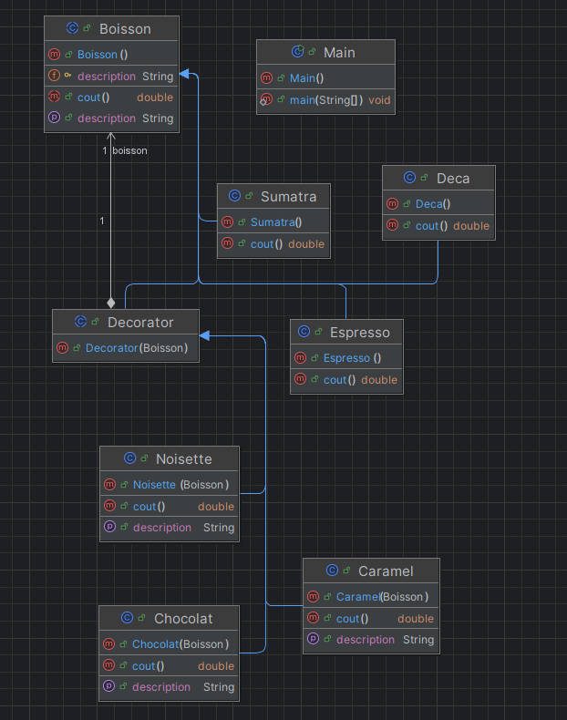
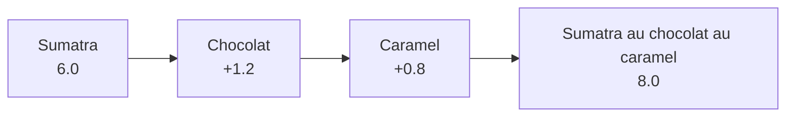
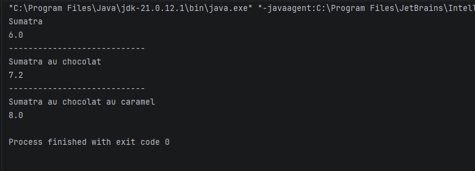

# Decorator-DesignPattern


---

## Table des matières

2. [Le pattern Decorator](#le-pattern-decorator)
3. [Structure du projet](#structure-du-projet)
4. [Architecture et diagrammes](#architecture-et-diagrammes)
5. [Description des classes](#description-des-classes)
6. [Tarifs](#tarifs)
7. [Scénario de démonstration](#scénario-de-démonstration)
10. [Résultat attendu](#résultat-attendu)
11. [Ajouter un nouveau supplément ou une nouvelle boisson](#ajouter-un-nouveau-supplément-ou-une-nouvelle-boisson)
14. [Auteur](#auteur)

---

## Présentation

Le projet modélise une carte de boissons :

- **boissons de base** (composants) : `Espresso`, `Deca`, `Sumatra` ;
- **suppléments** (décorateurs) : `Chocolat`, `Caramel`, `Noisette`.

Chaque supplément « enveloppe » une boisson et modifie son **coût** et sa **description**, sans changer la classe de la boisson d'origine. On peut empiler autant de suppléments que l'on veut, dans n'importe quel ordre.

---

## Le pattern Decorator

Le **Decorator** est un pattern structurel. Il permet d'**ajouter dynamiquement des responsabilités** à un objet en l'enveloppant dans un objet décorateur qui partage la même interface (ou classe abstraite).

**Problème résolu :** sans ce pattern, il faudrait une sous-classe pour chaque combinaison (`EspressoChocolat`, `EspressoChocolatCaramel`, `SumatraCaramel`...), soit une **explosion de classes**.

---

## Structure du projet

```
Decorator-DesignPattern/
├── pom.xml
├── .gitignore
└── src/
    └── main/
        └── java/
            └── com/
                └── zouhari/
                    ├── Main.java                   # Démonstration
                    ├── composant/
                    │   ├── Boisson.java            # Classe abstraite (composant)
                    │   ├── Espresso.java           # Composant concret
                    │   ├── Deca.java               # Composant concret
                    │   └── Sumatra.java            # Composant concret
                    └── decorateur/
                        ├── Decorator.java          # Décorateur abstrait
                        ├── Chocolat.java           # Décorateur concret
                        ├── Caramel.java            # Décorateur concret
                        └── Noisette.java           # Décorateur concret
```

---

## Architecture et diagrammes

### Diagramme de classes



### Principe d'empilement



Chaque décorateur **délègue** à la boisson qu'il enveloppe (`boisson.cout()`, `boisson.getDescription()`) puis y ajoute sa propre contribution.

---

## Description des classes

### `Boisson` (composant abstrait)

Définit le contrat commun à toutes les boissons et à tous les décorateurs :

```java
public abstract class Boisson {
    protected String description;

    public String getDescription() { return description; }
    public abstract double cout();
}
```

### Composants concrets (`composant`)

| Classe | Description | Coût |
|---|---|---|
| `Espresso` | `Espresso` | 12.0 |
| `Deca` | `Décaféiné` | 8.0 |
| `Sumatra` | `Sumatra` | 6.0 |

### `Decorator` (décorateur abstrait)

Hérite de `Boisson` (ce qui le rend substituable à une boisson) et **contient** une `Boisson` enveloppée :

```java
public abstract class Decorator extends Boisson {
    protected Boisson boisson;

    public Decorator(Boisson boisson) { this.boisson = boisson; }
}
```

### Décorateurs concrets (`decorateur`)

| Classe | Supplément de prix | Ajout à la description |
|---|---|---|
| `Chocolat` | + 1.2 | ` au chocolat` |
| `Caramel` | + 0.8 | ` au caramel` |
| `Noisette` | + 1.2 | ` au Noisette` |

Exemple (`Caramel`) :

```java
@Override public double cout() {
    return 0.8 + boisson.cout();
}
@Override public String getDescription() {
    return boisson.getDescription() + " au caramel";
}
```

---

## Tarifs

| Boisson de base | Prix | Supplément | Prix |
|---|---|---|---|
| Espresso | 12.0 | Chocolat | + 1.2 |
| Décaféiné | 8.0 | Caramel | + 0.8 |
| Sumatra | 6.0 | Noisette | + 1.2 |

---

## Scénario de démonstration

La classe `Main` construit une boisson par empilement successif :

```java
Boisson boisson1 = new Sumatra();
System.out.println(boisson1.getDescription());
System.out.println(boisson1.cout());

boisson1 = new Chocolat(boisson1);      // Sumatra + chocolat
System.out.println(boisson1.getDescription());
System.out.println(boisson1.cout());

boisson1 = new Caramel(boisson1);       // + caramel
System.out.println(boisson1.getDescription());
System.out.println(boisson1.cout());
```

---


## Résultat attendu



| Étape | Description | Calcul | Coût |
|---|---|---|---|
| Boisson de base | Sumatra | 6.0 | 6.0 |
| + `Chocolat` | Sumatra au chocolat | 1.2 + 6.0 | 7.2 |
| + `Caramel` | Sumatra au chocolat au caramel | 0.8 + 7.2 | 8.0 |

---

## Ajouter un nouveau supplément ou une nouvelle boisson

### Nouveau supplément

Créer une classe qui étend `Decorator` dans `com.zouhari.decorateur` :

```java
package com.zouhari.decorateur;

import com.zouhari.composant.Boisson;

public class Vanille extends Decorator {
    public Vanille(Boisson boisson) { super(boisson); }

    @Override public double cout() { return 0.9 + boisson.cout(); }
    @Override public String getDescription() {
        return boisson.getDescription() + " à la vanille";
    }
}
```


### Nouvelle boisson de base

Créer une classe qui étend `Boisson` dans `com.zouhari.composant`, renseigner `description` dans le constructeur et implémenter `cout()`.

---


## Auteur

**ZOUHARI Dyae Errahmane** --- [GitHub](https://github.com/zouharidyaeerrahmane)